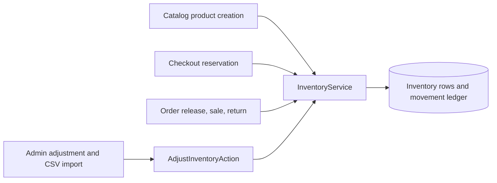

# System Overview

## Quality priorities
1. Money and stock correctness.
2. Customer privacy and admin authorization.
3. Fast catalog browsing.
4. Clear boundaries that support later payment and carrier integrations.

## Context and constraints
Single-vendor; Laravel API and two independent React/Vite TypeScript SPAs; MySQL; JWT access + rotating opaque refresh; Vietnamese/VND. Local development runs on the host through `npm run dev` with MySQL and a database queue. Redis is optional locally and available for production cache/queue. Storefront supports configured COD and manually reconciled bank transfer/VietQR (ADR-0018).

## Component boundaries
- API owns all business decisions, authentication, roles, persistence, and authoritative totals.
- Admin owns staff workflows; it never has direct database access.
- Storefront owns customer presentation and optimistic cart UX; client calculations are estimates only.
- Payment and shipping use domain boundaries. COD and configured manual bank transfer are supported; provider gateway flags alone never enable an unimplemented checkout integration. Shipping uses configured rates and methods.
- Admin and Storefront use the current province/commune catalog; old district values remain readable in historic snapshots (ADR-0012, ADR-0013).
- Inventory is the single owner of stock quantity and movement writes; checkout, orders, catalog initialization, and admin adjustment call its public service within their business transactions (ADR-0009).
- Inventory owns both the online fulfillment pool and isolated per-store pickup balances. Pickup availability is cart-wide, checkout locks and reserves the selected branch rows, and all branch adjustments/sales/releases/returns append to the shared movement ledger with a store reference (ADR-0019).
- Admin manages the ordered visibility list for supported Storefront home sections through the existing settings boundary; public configuration exposes only validated section keys (ADR-0017).

## Request path and ownership

Browser → typed HTTP client → versioned route → authentication/audience and permission middleware → Form Request → domain action/service → Eloquent transaction → API Resource → browser.

Business rules live in Laravel domain modules. Admin and Storefront own separate routes and feature modules; `api/openapi.yaml` defines their shared API contract. Client permission checks control presentation; only the API grants access.

## Cross-module behavior

- Product-level sale dates gate effective variant discounts. Catalog, cart, checkout, and manual-order flows calculate prices on the server; order items preserve their placement-time price snapshot (ADR-0011).
- A bank-transfer order snapshots bank instructions and exposes a scoped payment-page capability. VietQR displays transfer details; only authorized staff reconciliation marks payment received. Expired unpaid orders release reservations through the order transition flow (ADR-0018).
- Admin localization uses bundled i18next resources and the existing account appearance preference. Vietnamese is the default/fallback and Storefront language remains independent (ADR-0015).
- System backups use Spatie Laravel Backup on the Linux deployment target. Manual runs are queued, metadata is retained, and private downloads require `system.backup`; the host needs PHP ZIP and the database dump binary (ADR-0014).
- Public Storefront pages use the client-rendered Vite SPA. Build-time SEO snapshot scripts were removed; Laravel continues to provide the public sitemap and robots endpoints (withdrawn ADR-0016).

## Inventory write flow

## NFR to design choices
| Requirement | Design response |
|---|---|
| NFR-PERF-001 | Indexed filtering, server pagination, eager loading, cache public navigation data |
| NFR-PERF-002 | Responsive images, lazy routes/images, small initial bundle; SPA limitation documented |
| NFR-SEC-001/002/003 | In-memory access token, httpOnly refresh, server-side authorization and totals |
| NFR-A11Y-001 | Semantic controls, focus/keyboard support, contrast and form labels |
| NFR-OBS-001 | Request correlation ID, structured logging, no credentials in logs |
| NFR-AVAIL-001 | Database backups, queue monitoring, health endpoint and restore runbook |

## Deployment shape
Nginx terminates TLS and serves the two SPAs; API is a separate PHP-FPM service; MySQL is persistent; Redis runs queue/cache; a worker and scheduler run separately. See `deployment.md`.
