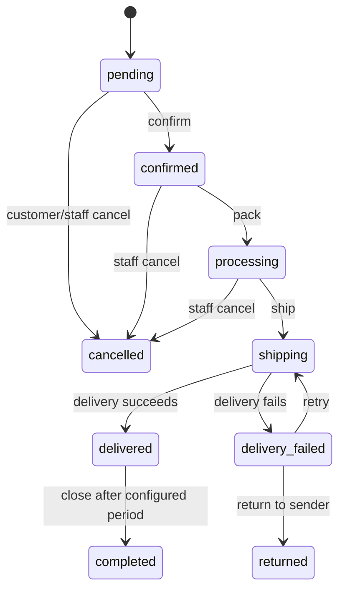

# Order Lifecycle

All transitions go through `TransitionOrderAction`; reject invalid edges with `INVALID_ORDER_TRANSITION` and append `order_status_histories`. Customers submit cancellation requests for pending, confirmed, or processing orders and return requests for delivered or completed orders within seven days of `orders.delivered_at`, inclusive of the exact deadline. The API is authoritative and rejects a return request when the delivery timestamp is absent or the deadline has passed. Staff review requests with `orders.update_status`. Cancellation approval transitions through the state machine and releases stock/coupon reservations atomically. A delivered/completed order can transition to `returned` only when it has an approved return request; return approval alone does not change order state or stock. After receipt, staff confirms the return by transitioning to `returned`, restoring stock and adjusting sold counts through `InventoryService`. At COD delivery, mark payment paid only when collection is confirmed. Refunds remain manual; the system does not automate refund payment or returned-goods inspection.

Admin staff confirm every single or bulk status transition in the UI. They may add a note, which is stored with that transition's history record. Cancellation requires selecting a reason; choosing “Khác” requires a short explanation, and the resulting human-readable reason is recorded in order history. Delivery separately confirms whether COD was collected.
